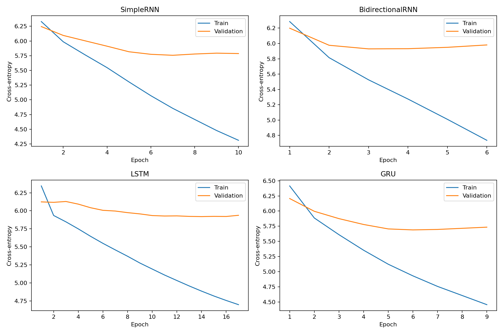
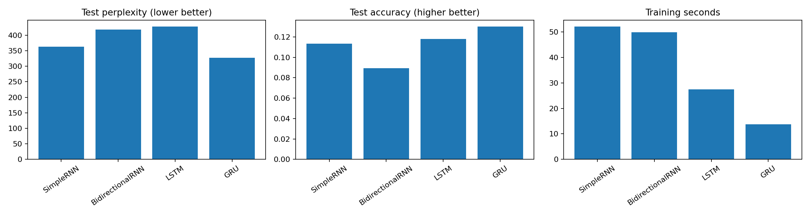
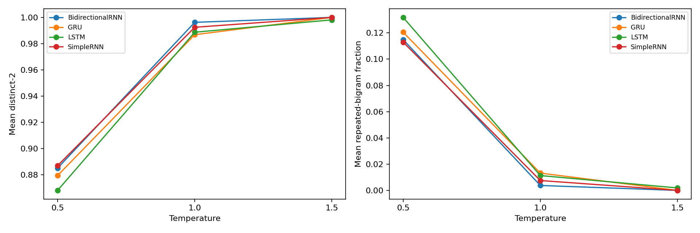

# AliceText: Recurrent Next-Word Generation
ICT4403 Foundations of Generative AI — Assignment 2

## Objective
Implement Simple RNN, Bidirectional Simple RNN, LSTM and GRU next-word models and compare quantitative and qualitative generation performance.

## Dataset
Alice's Adventures in Wonderland by Lewis Carroll.
Source: https://www.gutenberg.org/ebooks/11
Download: https://www.gutenberg.org/ebooks/11.txt.utf-8
Cleaned words: 26661. Training vocabulary including PAD/UNK: 2317.
Remove boilerplate and contents; lowercase, retain word-internal apostrophes, discard punctuation.
Chronological 80/10/10 split before window creation. Vocabulary fitted on training only.

| split | words_used | sequences | unknown_fraction |
| --- | --- | --- | --- |
| train | 21328 | 21308 | 0.0 |
| validation | 2666 | 2646 | 0.0863 |
| test | 2667 | 2647 | 0.0855 |

## Model descriptions
- **Simple RNN:** a tanh hidden state carries information between words.
- **Bidirectional RNN:** concatenates forward and backward Simple RNN representations of the observed context.
- **LSTM:** uses input, forget and output gates and a cell state to control information retention.
- **GRU:** uses reset and update gates to control its recurrent hidden state.
All four map the recurrent representation to vocabulary logits and predict the next word.

## Models and protocol
64-dimensional embeddings; 128 recurrent units per direction; dropout 0.2; vocabulary logits.
Bidirectional RNN sees only the available preceding context in both directions.
Context 20, batch 128, Adam 0.001, gradient clipping 1.0,
maximum 20 epochs, validation-loss early stopping patience 3 and best checkpoint.
Identical training policy and seed 42; parameter counts differ.
Quick run: False. Quick runs are not final experiments.

## Execution
Open `FGAI_Assignment2_Colab.ipynb` in Google Colab and select a GPU runtime if available.
Run the cells in order with `QUICK_RUN=False` and `USE_DRIVE=False`, as in the recorded experiment.
No Google Drive authorization is required. Outputs are written to `/content/FGAI_Assignment2/full_run`.
Download the results ZIP and executed notebook before the temporary runtime is deleted.
To retain checkpoints, download the `models/` files separately; the lightweight ZIP excludes them.
To rerun with changed settings, use a new output folder. Completed checkpoints are reused only when
saved metadata matches the configuration. Drive storage is optional via `USE_DRIVE=True`.
For local execution, install requirements.txt and set USE_DRIVE=False.
See config.json for the exact software versions and dataset hash of this run.

## Results
| model | parameters | epochs | best_epoch | training_seconds | validation_loss | test_loss | test_perplexity | test_accuracy |
| --- | --- | --- | --- | --- | --- | --- | --- | --- |
| SimpleRNN | 471885 | 10 | 7 | 52.0406 | 5.757 | 5.8946 | 363.089 | 0.1133 |
| BidirectionalRNN | 793165 | 6 | 3 | 49.8191 | 5.9294 | 6.0358 | 418.1172 | 0.0892 |
| LSTM | 545997 | 17 | 14 | 27.413 | 5.9195 | 6.0581 | 427.5775 | 0.1179 |
| GRU | 521677 | 9 | 6 | 13.7905 | 5.6887 | 5.7896 | 326.8875 | 0.13 |

Perplexity is exp(test cross-entropy); accuracy is top-1 next-word accuracy.
Lowest validation-loss model: **GRU**. Qualitative review and the scope of this conclusion are discussed below.
Training time includes fit/validation/checkpoint writing; it depends on hardware and storage.

## Model comparison and evaluation
GRU achieved the lowest validation loss (5.6887), lowest test loss (5.7896), lowest test perplexity (326.8875), highest test accuracy (13.00%) and shortest recorded fit time (13.79 seconds). Its perplexity is about 9.97% lower than Simple RNN's, and accuracy is about 1.67 percentage points higher. These results make GRU the strongest quantitative choice in this experiment.

Simple RNN was second by test loss and perplexity. LSTM had slightly higher accuracy than Simple RNN (11.79% versus 11.33%), but worse perplexity (427.58 versus 363.09). This is possible because top-1 accuracy measures whether the highest-probability word matches, whereas cross-entropy considers the probability assigned to the actual target in every example.

Bidirectional RNN had the largest parameter count (793,165) and the lowest test accuracy (8.92%). Processing the observed context in both directions did not improve these results. Its larger capacity and the small corpus are possible contributors, but this experiment does not isolate the cause. No future target word is supplied to the backward branch.

The learning curves show a growing training–validation gap for every architecture. Validation loss reaches its minimum at epochs 7, 3, 14 and 6 for Simple RNN, Bidirectional RNN, LSTM and GRU respectively, while training loss continues falling. Early stopping terminates at epochs 10, 6, 17 and 9 and retains the best checkpoints. This is evidence of overfitting, not a training failure.

The reported times compare this particular execution, including tracing, validation and checkpoint I/O. They are not pure measures of architectural complexity. Different stopping epochs, runtime kernels, caching and fixed model order can affect them. The experiment does not profile why the gated models ran faster.

## Temperature analysis
Temperatures [0.5, 1.0, 1.5]; 3 common training prompts; 3 sampling repetitions;
60 generated words per sample. Total 108 samples.
See results/generated_samples.txt, results/temperature_summary.csv and plots/temperature_analysis.png.
PAD/UNK are excluded during generation only. No top-k filtering.
Distinct-n measures variety; repeated-bigram fraction = 1 - distinct-2.
### Measured diversity
The following means each summarize nine continuations: three seeds × three sampling repetitions.
The full CSV additionally gives sample standard deviations across those nine continuations; these are
not confidence intervals across independently trained models.

| model | temperature | distinct_1 | distinct_2 | repeated_bigram_fraction |
| --- | --- | --- | --- | --- |
| BidirectionalRNN | 0.5 | 0.546 | 0.885 | 0.115 |
| BidirectionalRNN | 1.0 | 0.839 | 0.996 | 0.004 |
| BidirectionalRNN | 1.5 | 0.933 | 1.0 | 0.0 |
| GRU | 0.5 | 0.574 | 0.879 | 0.121 |
| GRU | 1.0 | 0.813 | 0.987 | 0.013 |
| GRU | 1.5 | 0.944 | 1.0 | 0.0 |
| LSTM | 0.5 | 0.557 | 0.868 | 0.132 |
| LSTM | 1.0 | 0.8 | 0.989 | 0.011 |
| LSTM | 1.5 | 0.939 | 0.998 | 0.002 |
| SimpleRNN | 0.5 | 0.574 | 0.887 | 0.113 |
| SimpleRNN | 1.0 | 0.798 | 0.992 | 0.008 |
| SimpleRNN | 1.5 | 0.944 | 1.0 | 0.0 |

Distinct-1 is unique generated words / 60; distinct-2 is unique generated bigrams / 59.
Repeated-bigram fraction is 1 − distinct-2, so it is mathematically redundant with distinct-2,
not an independent quality measure. Prompts and prompt-to-generation boundary bigrams are excluded.

### Effect of temperature
At **T=0.5**, mean distinct-1 lies between 0.546 and 0.574 and repeated-bigram fraction between 0.113 and 0.132. Outputs favor common words and recognizable dialogue patterns but reuse phrases. This setting is the most readable of those examined, although sentences are still frequently ungrammatical and narrative coherence is weak.

At **T=1.0**, mean distinct-1 increases to 0.798–0.839 and repeated-bigram fraction falls to 0.004–0.013. More words appear, but the reviewed outputs have broken syntax and poor context retention. For example, LSTM seed 1 begins “the think for cherry beating arches”. Thus 1.0 is not automatically the best compromise for these undertrained language patterns.

At **T=1.5**, mean distinct-1 reaches 0.933–0.944 and repetition is near zero (0–0.002). Many continuations resemble disconnected word lists. GRU seed 1 begins “you he sir loose painting pleasanter”. An absence of repeated bigrams does not establish coherence or meaningful diversity.

### Review across all three seed sequences
The seeds are 20-word contexts sampled from three positions in the training section; see `results/seeds.json`. They concern (1) Alice sitting by her sister, (2) Alice hearing something after attempting a snatch, and (3) the Dormouse speaking. Generation uses the same seeds and sampling random seeds for each model and temperature.

A descriptive, AI-assisted review covers **36 continuations**: repetition 1 of every model × seed × temperature combination. The quantitative analysis uses **all 108 continuations**. The review is recorded in `results/qualitative_review.csv` with individual excerpts. These observations are not independent human ratings or a validated preference study.

| Model | Observations at T=0.5 across seeds 1, 2 and 3 |
| --- | --- |
| Simple RNN | Seed 1 contains “i don't know it said the caterpillar”; seed 2 starts with “thing” but shifts among unrelated characters; seed 3 mentions Dormouse yet moves to Duchess and Queen. Local phrases are recognizable, but events are not connected. |
| Bidirectional RNN | Seed 1 loops on “of of of”; seed 2 repeats “the mock hare”; seed 3 reuses “to know”. It has conspicuous local repetition and weak grammar. |
| LSTM | Seed 1 uses dialogue formulas but also “a three turtle”; seed 2 includes “no went in the haven't”; seed 3 repeats “was a minute”. Plausible short phrases do not form a meaningful continuation. |
| GRU | Seed 1 includes “off in a minute”; seed 2 mentions “a little voice”, loosely related to the hearing prompt; seed 3 retains “dormouse” and “voice” briefly but switches characters and contains “the dormouse were an cushion moment”. It remains locally readable only in fragments. |

All models reuse the book's character names, but thematic vocabulary is not equivalent to contextual consistency. Seed 1 ends in “nothing to”, and all four T=0.5 samples start with “the”, failing to complete the immediate phrase. GRU seed 2 also repeats “little” across the prompt/output boundary; the automated continuation-only repetition score intentionally does not count this boundary.

At 1.0 and 1.5, the same deterioration in grammar and seed continuity is visible across the other two seeds, not only seed 1. The 36 reviewed continuations do not establish a clear qualitative advantage of GRU over both LSTM and Simple RNN. They do support preferring T=0.5 for relative readability within the tested settings.

## Conclusion
**GRU with temperature 0.5 is the recommended configuration for this dataset and experiment.** GRU leads all quantitative prediction measures and has the lowest recorded training time. Temperature 0.5 yields more recognizable phrases than 1.0 or 1.5, at the cost of repetition. This is a practical choice based primarily on predictive performance and efficiency; the reviewed samples do not prove GRU is uniquely superior in narrative quality. None of the four models produces consistently coherent stories.

Limitations include a single short book, a single training random seed, only three prompts, subjective descriptive review, unequal parameter counts and a fixed 20-word context. Approximately 8.6% of held-out tokens are unknown: they are scored as `<unk>` during evaluation, so perplexity refers to the training-vocabulary representation rather than exact unseen words. PAD/UNK are suppressed only when generating. Punctuation is discarded, preventing punctuation-quality evaluation. Chronological splitting prevents overlapping windows across partitions but creates narrative/topic shifts. Timing is specific to this run; the exact GPU model was not recorded. No statistical significance is claimed.

A stronger follow-up would use a larger corpus, multiple training seeds, a parameter-matched comparison, an explicit simple language-model baseline, and independent human evaluation. Those additional experiments were not performed here.

## Files
- `FGAI_Assignment2_Colab.ipynb`: implementation, explanations, original executed outputs and appended result analysis.
- config.json: experimental configuration and versions.
- `data/`: training vocabulary. Source text is downloaded on execution; raw and cleaned corpora are not bundled.
- results/: metrics, histories, generations, diversity statistics and qualitative worksheet.
- plots/: learning curves, comparison and temperature plots.
- models/: locally saved checkpoints (excluded from the lightweight repository ZIP).

Retain the Project Gutenberg notice if redistributing the original source text.

## Reproducibility and review status
The notebook was executed by the student in Colab. Training outputs and numerical result files are retained from that run; no model was retrained during packaging. The final discussion and descriptive text review were prepared with AI assistance and should be read and verified by the student before submission. No independent human scores have been invented.

Verification checked 108 unique model/seed/temperature/repetition combinations, 60-word continuation lengths, recomputed diversity values, perplexity = exp(loss), and agreement of best epochs with training histories. The notebook has no saved error outputs. The recorded environment is Python 3.13.15, TensorFlow 2.21.0 and NumPy 2.1.3; additional dependencies appear in requirements.txt. The saved code still contains the original README/worksheet generation templates; the completed files in this repository supersede those starter templates. Rerunning in a fresh output folder produces templates, which must be interpreted for the new results.
